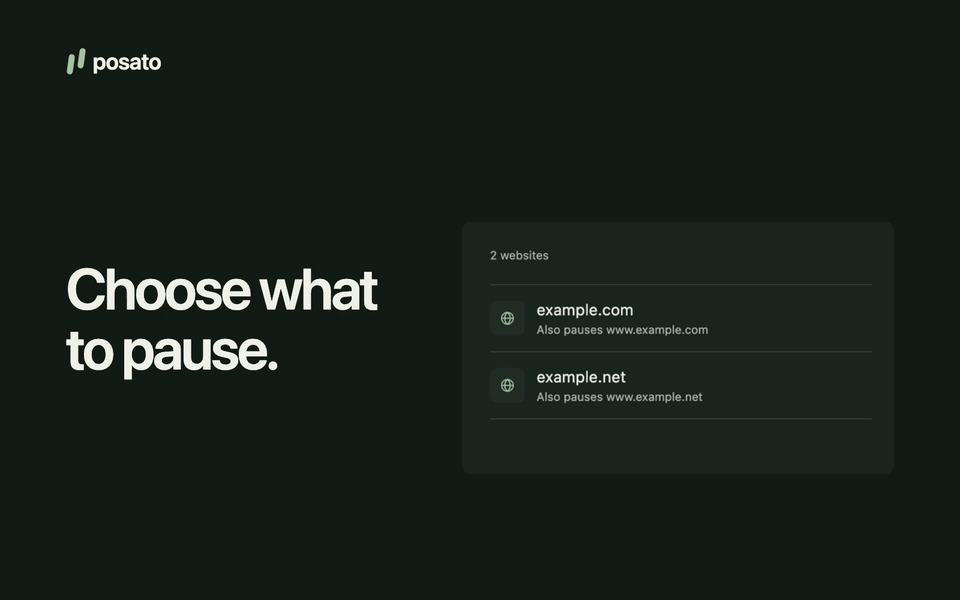
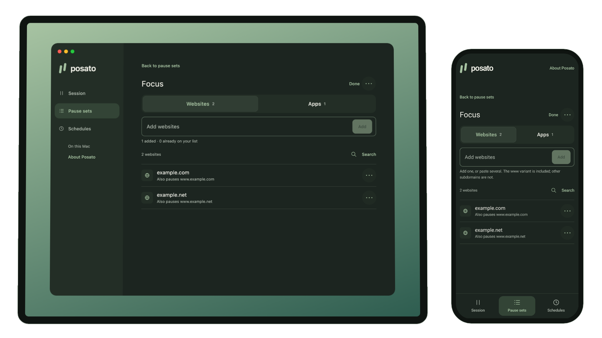
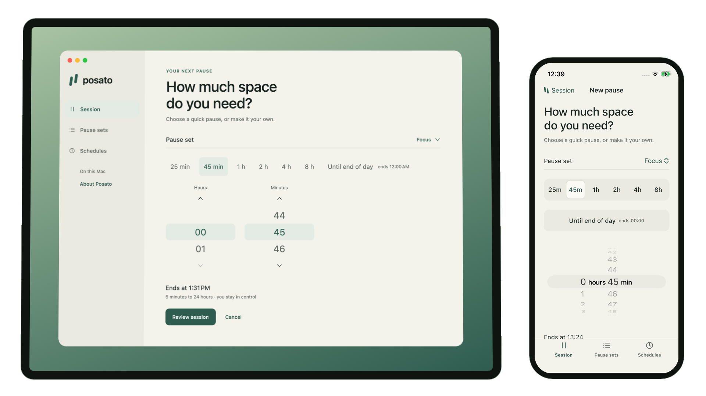
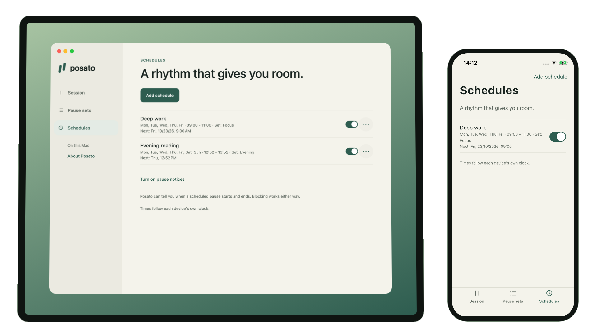
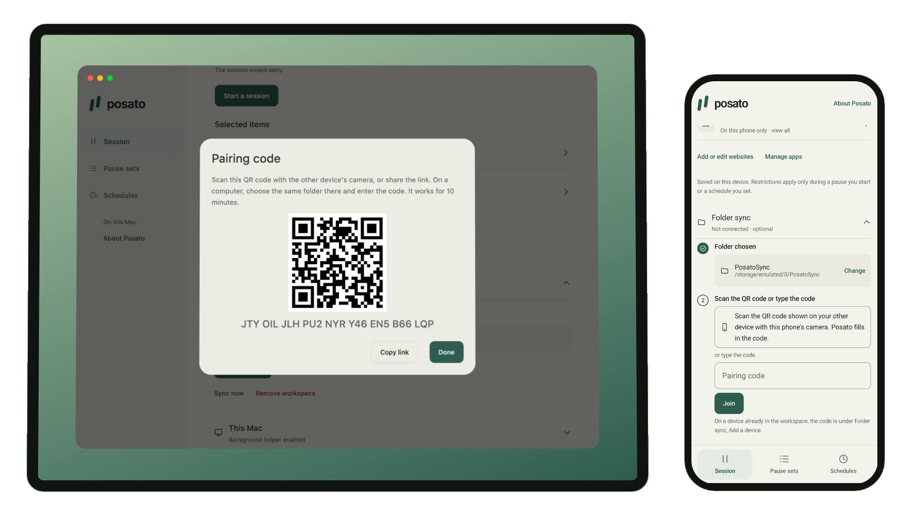
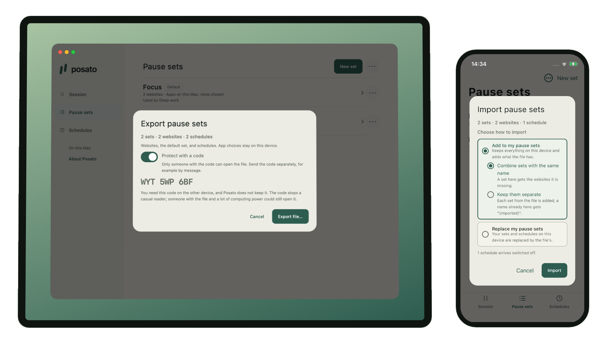

# Posato

**A little space. For what matters.**

Posato blocks the websites and apps you choose for a timed pause on your Mac,
iPhone, Linux computer, or Android phone, now or on a schedule, within the
[limits](#limits) below.

  

Watch the [full 53-second walkthrough](https://posato.app/media/walkthrough.mp4),
which adds opening a pause set, choosing apps on the Mac and the iPhone,
ending a session early, and a schedule whose pause starts on its own.

[Quick start](#quick-start) · [How it works](#how-it-works) ·
[Limits](#limits) · [Privacy](#privacy) · [Documentation](#project-documentation)

No Posato account, no analytics, and no Posato-operated server.
Open source under the [Apache License 2.0](LICENSE).

## Quick start

  
  
  
  

- **Mac:** download the signed and notarized DMG from
  [GitHub Releases](https://github.com/dees91/posato/releases/latest), open it, and move Posato to your Applications folder.
  Choose `Posato-<version>.dmg` for Apple silicon or `Posato-<version>-intel.dmg`
  for an Intel Mac.
  Posato 1.1 and later can check for updates after you agree; to move from 1.0,
  quit Posato and replace it with the new version.
- **iPhone:** install Posato from the [App Store](https://apps.apple.com/app/posato/id6812237585).
- **Linux:** download the package for your computer from
  [GitHub Releases](https://github.com/dees91/posato/releases/latest):
  `posato_<version>_arm64.deb` for arm64 or `posato_<version>_amd64.deb` for
  x86-64. Install it with `sudo apt install ./posato_<version>_<arch>.deb`,
  then open Posato and follow the first run. It asks for your password once
  to install the pausing service.
- **Android:** on the phone, download `Posato-<version>.apk` from
  [GitHub Releases](https://github.com/dees91/posato/releases/latest) and
  open it. When Android asks, allow installing apps from this source, then
  install, open Posato, and follow the first run, which asks for the
  permissions Posato needs to pause.

To update on Linux or Android, install the newer package the same way.

Posato targets **macOS 13 or later on Apple silicon and Intel Macs**,
**iOS 18 or later**, **Ubuntu 24.04 or later**, and **Android 13 or later**;
the [platform matrix](docs/product/limits-and-platforms.md#supported-platforms)
records what was checked on each of them. Windows is
[planned for a later release](docs/product/limits-and-platforms.md#planned-platforms).

To build it yourself, follow the [build instructions](docs/development/README.md#build-from-source).
Unsigned builds let you explore the apps; blocking and sync require Apple
Development signing. The iOS Simulator cannot use Screen Time controls.

## How it works

### Choose what to pause

Group what you want to pause into pause sets, such as one for work and one
for evenings. A set holds exact website domains and, on each device, the apps
you choose there. One set is the default; pick another when you start a pause
or plan a schedule. App choices stay on the device where you made them.

  

### Start a timed pause

Choose a pause set and a duration: a quick choice from 25 minutes to 8 hours,
**Until end of day**, or any length from **5 minutes to 24 hours** (up to 23
hours 59 minutes on iPhone). Review your
choices and start the session. Posato blocks your chosen websites and apps on that device,
within the [limits](#limits) below. The session ends at the selected time or
when you deliberately end it early. On iPhone, restrictions can linger after it
ends. On a Mac, a one-time setup lets pauses and schedules start without asking
for your password each time.

  

Screenshots and the demo show synthetic choices in the real apps on a Mac,
an iPhone, and an Android phone, and the demo names Linux too; see the
[capture provenance](video/README.md#capture-provenance).

### Plan pauses ahead

Add a schedule with a name, a pause set, weekdays, and hours, such as weekday
mornings from 9 to 11. It starts and ends on its own on each device you set up, even with
Posato's window closed on a computer or the app closed on a phone. Skip the next one or end one
early when plans change. When pauses overlap, Posato pauses everything in
their sets, within each device's limits, and each item stays paused until the
last pause that includes it ends. On Mac and iPhone, Posato can tell you when a pause ends or when one
starts on another device.

  

### Share the session with iCloud

Choose **Sync with iCloud** on one Mac and one iPhone signed in to the same
Apple Account to share your pause sets with their websites, sessions, and
schedules. No QR code or invitation is needed. Delivery is best effort. A
session started on your iPhone blocks on the Mac only after you resume it there.
Update Posato on every device: once one device runs Posato 1.3, devices on an
earlier version stop syncing until they update.

### Sync through a folder

To link any mix of Mac, iPhone, Linux, and Android, keep the workspace in a
folder that Dropbox, OneDrive, Syncthing, iCloud Drive, or another service
keeps in sync. Posato writes only encrypted files there. A workspace uses
iCloud or one folder, never both. Create the workspace on one device, then
choose **Add a device** there. On the other device, take two steps in either
order: choose its copy of the same folder, and scan the QR code with the
phone's camera, open the shared link, or type the pairing code. It joins as
soon as it has both. The code works for 10 minutes. A device that joins
during a pause starts pausing right away. You cannot remove a single device;
to stop sharing with one, remove the workspace and create a new one in
another folder.

  

### Copy pause sets with a file

To set up a device outside your workspace, such as a Mac on another Apple
Account, choose **Export pause sets…** from the **…** menu in **Pause sets**.
The `.posato` file holds your pause sets with their websites, the default
set, and your schedules, never app choices. **Protect with a code** encrypts
it with a nine-character code that Posato shows once. On the other device,
choose **Import…** to add the sets to yours or replace them; imported
schedules arrive switched off. It is a one-time copy, not sync.

  

## Limits

Posato adds deliberate friction; it is not a lock you cannot open.

- **Mac:** blocking works while Posato runs, including in the menu bar with
  its window closed. Quitting Posato stops it and new scheduled starts.
  Blocking needs administrator approval; after the one-time setup, starts no
  longer ask for it. Paused apps are quit, so save your work first.
  Website blocking covers Safari and Google Chrome Stable using the system
  proxy.
- **iPhone:** restrictions can linger after a session ends. For sessions under
  15 minutes, they clear only when Posato is open at the end or the next time
  you open it.
- **Linux:** websites are blocked by name through `/etc/hosts`, with no pause
  page; a browser with its own DNS over HTTPS bypasses it. Paused apps are
  ended, so save your work first. A system service, installed once with your
  password, ends the pause on time even when Posato is closed. Closing the
  window keeps Posato running with an icon in the status area. On a desktop
  whose status area does not show app icons, such as GNOME without the
  AppIndicator extension, there is no icon, and Posato stays in the
  background only while a pause runs or a schedule is on. Quitting Posato
  stops new scheduled starts.
- **Android:** websites are blocked by name through a local VPN, with no
  pause page; another VPN cannot run during a pause, and strict Private DNS
  or a browser with its own DNS over HTTPS bypasses it. A paused app is
  covered by a block screen.
- **Sync:** delivery is best effort. If every copy of your workspace key is
  lost, synchronized data cannot be recovered.

Read the [full blocking and sync limits](docs/product/limits-and-platforms.md#limits)
for browser coverage, VPN and Private Relay behavior, resuming after sleep,
folder sync and pairing codes, and data recovery boundaries.

## Privacy

Posato does not collect your data. Your pause sets, websites, app choices,
sessions, and schedules stay on your devices; with iCloud sync on, changes are encrypted on your device
before they are stored in your private iCloud database, and with folder sync,
Posato writes only encrypted files to the folder you choose. On Mac, update checks go
to GitHub Releases only after you agree. See the [privacy policy](PRIVACY.md).

## Support and security

- Report bugs, ask questions, and share ideas in [GitHub Issues](../../issues).
  Please do not include website names, app names, device details, screenshots,
  or logs.
- Report security vulnerabilities privately, as described in the
  [security policy](SECURITY.md).
- Pull requests are not accepted at the moment; see
  [contributing](CONTRIBUTING.md).

## Project documentation

- [Development guide](docs/development/README.md) and
  [engineering quality contract](docs/development/engineering-quality-contract.md)
- [MVP scope](docs/product/mvp-scope.md) and [design system](DESIGN.md)
- [Architecture decisions](docs/decisions/) and
  [threat model](docs/security/apple-mvp-threat-model.md)
- [Project wiki](docs/wiki/index.md), including feasibility results that informed
  the design, and the [task workflow](docs/tasks/README.md)

## License

Posato is licensed under the [Apache License 2.0](LICENSE). See [NOTICE](NOTICE)
and [third-party notices](THIRD_PARTY_NOTICES.md).
